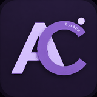
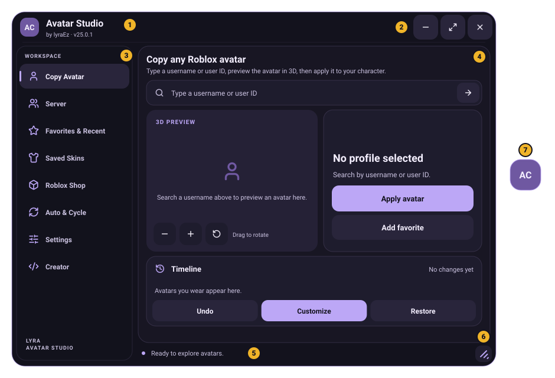

  

<h1 align="center">Avatar Copier docs</h1>

What every tab does, how to use it, and where it lives in the code.

---

## New here?

1. **[Getting started](getting-started.md)**: run the script and wear your first copied avatar.
2. **[The window](features/window.md)**: a map of the window and how to hide and bring it back.
3. Open the page of the tab you want to use, below.

  

## The tabs

One page per tab of the window, in the same order as the side menu.

| | Tab | What it's for | Built by |
| :-: | --- | --- | --- |
|  | **[Copy Avatar](tabs/copy-avatar.md)** | Search anyone, look at their avatar in 3D, wear it. Undo and Restore. | [`UI.buildAvatar`](../src/avatar-copier.lua#L3913-L3971) |
|  | **[Server](tabs/server.md)** | Wear or preview anyone in your server with one tap. | [`UI.buildPlayers`](../src/avatar-copier.lua#L4114-L4123) |
|  | **[Favorites & Recent](tabs/favorites-recent.md)** | Profiles you starred and the ones you looked at lately. | [`UI.buildCollection`](../src/avatar-copier.lua#L4143-L4161) |
|  | **[Saved Skins](tabs/saved-skins.md)** | Save what you wear, wear it again anywhere, share it as a code. | [`UI.buildLooks`](../src/avatar-copier.lua#L4324-L4377) |
|  | **[Roblox Shop](tabs/roblox-shop.md)** | Try catalog items, bundles, animations and emotes on your avatar. | [`UI.buildCatalog`](../src/avatar-copier.lua#L4646-L4703) |
|  | **[Auto & Cycle](tabs/auto-cycle.md)** | An avatar on start, and a new avatar every death or every few minutes. | [`UI.buildAuto`](../src/avatar-copier.lua#L4885-L4959) |
|  | **[Settings](tabs/settings.md)** | Every option, its default and the code that reads it. | [`UI.buildSettings`](../src/avatar-copier.lua#L4762-L4807) |
|  | **[Creator](tabs/creator.md)** | The author's Discord and GitHub. | [`UI.buildCreator`](../src/avatar-copier.lua#L5181-L5232) |

## Features that work across tabs

| | Page | What it covers |
| :-: | --- | --- |
|  | **[The window](features/window.md)** | Moving, resizing, phone layouts, hiding and the four ways to reopen it. |
|  | **[Hotkeys and chat](features/hotkeys-and-chat.md)** | Free camera, left-hand copy, ToolsGiver, hiding the game's interface, chat commands. |
|  | **[Skin sync](features/skin-sync.md)** | Seeing other script users' skins. Off in this repository until you set a server. |
|  | **[Visual-only mode](features/visual-only.md)** | Drawing the avatar over your character for games that break when it changes. |

## Reference

For developers, or anyone curious about how it works.

| Page | What it covers |
| --- | --- |
| **[Architecture](reference/architecture.md)** | How the single file is organised and what happens when an avatar is applied. |
| **[Lifecycle](reference/lifecycle.md)** | Respawns, rounds, what is saved, Restore and cleanup. |
| **[Compatibility](reference/compatibility.md)** | R6, R15, custom rigs, game items, phones and executors. |
| **[Data formats](reference/data-formats.md)** | The saved file, share codes, the skin format and the skin sync protocol. |
| **[Configuration](reference/configuration.md)** | The `Config` table at the top of the script. |
| **[Development](reference/development.md)** | Checking a change, where to change things, the parts that need care, writing docs. |
| **[Troubleshooting](troubleshooting.md)** | Every message the script shows and what to do about it. |

## Reading the code links

Every page ends with an **Under the hood** section for the curious.

- A link like [`App.applySnapshot`](../src/avatar-copier.lua#L1654-L1801) opens the full script on GitHub with that function's lines highlighted.
- Setting names in [Settings](tabs/settings.md) link to the exact line that creates each switch.
- Code blocks are copied from the script. A line with only `…` means some lines were skipped.

> [!NOTE]
> The line numbers are checked on every change (`tools/doclinks.py`), so a link never points at the wrong lines.
