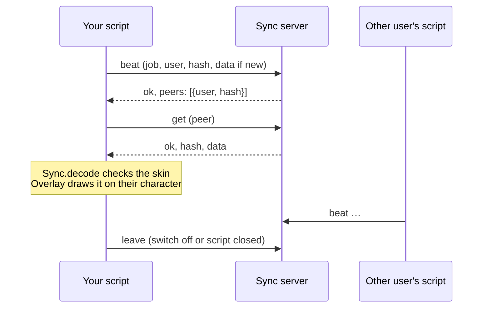

[Docs](../README.md) / Features / **Skin sync**

#  Skin sync

Normally only you see your copied avatar. Skin sync lets Avatar Copier users **in the same Roblox server** see each other's skins: each one shares the skin they wear through a small sync server, and draws the others' skins over their characters.

> [!IMPORTANT]
> **Skin sync is off in this repository.** `Config.SyncUrl` is empty and no sync server is included, so the script sends nothing. The **See other script users' skins** switch in Settings has no effect until you set an address. The rest of this page explains how it works and what a server must do.

## Turning it on

1. Run a server that speaks the [protocol](../reference/data-formats.md#skin-sync-protocol) (see [What a server must do](#what-a-server-must-do)).
2. Put its address in the `Config` table at the top of the script:

   ```lua
   SyncUrl = "https://your-server.example/v1/sync",
   ```
3. Keep **See other script users' skins** on in [Settings](../tabs/settings.md#avatar) (it is on by default). Everyone who wants to see each other needs the same address.

It only runs when all of these are true: the switch is on, `Config.SyncUrl` isn't empty, the executor has `request` (or `http_request` / `syn.request`), and you are in a live server (Roblox Studio has no `JobId`).

## What gets sent

While it runs, about every 8 seconds (5 seconds after your avatar changes):

| Sent | When |
| --- | --- |
| Your user ID and the server's `JobId` | Every time |
| A short hash of the skin you wear (empty when you wear your own avatar) | Every time |
| The skin itself, as JSON | Only when it changed, or when the server asks for it |

A skin longer than 250,000 characters is never shared; you appear as if wearing your own avatar.

> [!NOTE]
> The server learns your Roblox user ID (which anyone can turn into a username), the Roblox server you are in and the skin you wear, so it knows you use the script there. It never gets your saved skins, favorites or settings. Turning the switch off tells the server you left and removes every skin drawn on your screen.

## What you receive

Skins of the other users in the same Roblox server, which are:

- **checked like an imported share code** ([`Visual.validate`](../../src/avatar-copier.lua#L977-L1012) and [`Codec.decode`](../../src/avatar-copier.lua#L729-L799)), and refused when anything is out of range;
- **drawn as a separate local model** over the player's character ([Overlay](../reference/architecture.md#overlays)), so nobody's real character is ever changed;
- seen **only by you**. Players without the script see nothing different.

A skin that fails to download is retried after 8 s. One that can't be built waits 10 s longer after each failure, up to 60 s.

## How one round works



## What a server must do

A compatible server keeps the latest `hash` and `data` per `job` and `user`, lists the other users of the same `job` in `peers`, and forgets users who stop sending beats. Because **any client can post anything**, it should also:

- rate-limit by IP address, not only by the user ID the client sends;
- cap the size of each skin (the client never sends more than 250,000 characters) and the number of users per job;
- keep the data in storage of its own, separate from anything else, and delete old rows on a schedule;
- answer `{"ok": false}` to anything it refuses.

The full request and reply formats are in [Data formats](../reference/data-formats.md#skin-sync-protocol).

## Under the hood

| Part | Code | What it does |
| --- | --- | --- |
| The address | [`Sync.Url`](../../src/avatar-copier.lua#L5934) | Read from `Config.SyncUrl`. |
| On or off | [`Sync.enabled`](../../src/avatar-copier.lua#L5940-L5942) | Every condition listed above. |
| One request | [`Sync.call`](../../src/avatar-copier.lua#L5943-L5949) | POSTs JSON with the executor's `request`; ignores anything that isn't JSON. |
| Your skin | [`Sync.mine`](../../src/avatar-copier.lua#L5956-L5966), [`Sync.hash`](../../src/avatar-copier.lua#L5951-L5955) | The JSON of what you wear and its FNV-1a hash. |
| Heartbeat | [`Sync.beat`](../../src/avatar-copier.lua#L5978-L5997) | Sends your hash, resends with data when asked, reads the peer list. |
| Drawing others | [`Sync.draw`](../../src/avatar-copier.lua#L5998-L6034) | Fetches new skins and attaches overlays. |
| Checking a skin | [`Sync.decode`](../../src/avatar-copier.lua#L5968-L5977) | Size limit, JSON, `Visual.validate`, `Codec.decode`. |
| The loop | [`Sync.start`](../../src/avatar-copier.lua#L6035-L6054) | Runs every 2 s while the script is alive. |
| Leaving | [`Sync.stop`](../../src/avatar-copier.lua#L6056-L6060), [`Sync.close`](../../src/avatar-copier.lua#L6061) | Clears the overlays and sends `leave`. |

### Nothing runs without an address

```lua excerpt
Sync.Url = type(Config.SyncUrl) == "string" and Config.SyncUrl or ""
…
function Sync.enabled()
    return Store.Settings.SkinSync == true and App.alive() and not Sync.Closed and Sync.Url ~= "" and game.JobId ~= "" and Sync.requestFn() ~= nil
end
```

### Another user's skin is untrusted

```lua excerpt
-- Another user's skin is untrusted: it goes through the same checks as an imported skin code.
function Sync.decode(text)
    assert(type(text) == "string" and #text <= 262144, "Invalid skin.")
    local ok, packet = pcall(function() return HttpService:JSONDecode(text) end)
    assert(ok and type(packet) == "table" and packet.Version == 2 and type(packet.Data) == "table", "Invalid skin.")
    if packet.Data.Visual then Visual.validate(packet.Data.Visual) end
```

---

| ← Previous | Up | Next → |
| :--- | :---: | ---: |
| [Hotkeys and chat](hotkeys-and-chat.md) | [All docs](../README.md) | [Visual-only mode](visual-only.md) |
