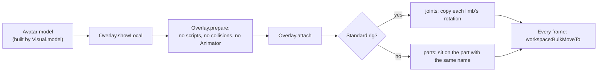

[Docs](../README.md) / Features / **Visual-only mode**

#  Visual-only mode

Some games break when the character's body changes: you can't move, you fall through the floor, or the game's own scripts reset you. **Visual-only avatar** avoids that. Instead of changing your character, the script draws the avatar as a separate model that follows your character every frame, and hides your real body on your screen.

| | Normal mode | Visual-only mode |
| --- | --- | --- |
| Your character's body | Changed in place (meshes, sizes, items) | Never touched |
| Game rig, joints, movement | Kept, but the body parts change | Exactly as the game made them |
| What you see | Your character with the new avatar | A copy of the avatar over your hidden character |
| Item recovery between rounds | Yes | Not needed |
| Other players | See your normal avatar | See your normal avatar |

## Turning it on

1. Open [Settings](../tabs/settings.md), tap **Show advanced options**.
2. Turn on **Visual-only avatar**.
3. Wear an avatar. The mode applies the **next** time you wear one.

> [!NOTE]
> In **Evade** visual-only mode is always on, because changing the character there breaks movement.

> [!WARNING]
> **Restore** in visual-only mode only removes the drawn avatar. If you applied an avatar normally and then turned visual-only on, turn it off and tap **Restore** again, or respawn.

## How the overlay follows you



- The overlay lives in the **camera**, which is local and out of reach of game scripts that scan the workspace for characters.
- Your real body and accessories are hidden with `Transparency`, because the camera keeps rewriting `LocalTransparencyModifier` on your own character. Tools you hold stay visible.
- In first person the overlay fades out when the camera is inside the head.
- About twice a second the overlay re-links parts the game rebuilt and hides parts that loaded late. If the game deletes the overlay, it is rebuilt from a spare copy, up to 20 times.
- Some games draw the visible body as a separate model named after the player (Evade keeps it in `workspace.Rigs`). The overlay follows and hides that model instead.

The same overlay is used to draw other players' skins in [Skin sync](skin-sync.md).

## Under the hood

| Part | Code | What it does |
| --- | --- | --- |
| Is it on? | [`Overlay.visualOnly`](../../src/avatar-copier.lua#L5546-L5548) | The setting, or the Evade game id. |
| Where overlays live | [`Overlay.folder`](../../src/avatar-copier.lua#L5550-L5560) | `LyraSkinOverlays` inside the camera. |
| The game's visible body | [`Overlay.renderRig`](../../src/avatar-copier.lua#L5563-L5586), [`Overlay.target`](../../src/avatar-copier.lua#L5587-L5589) | Finds a separate render model jointed to your root. |
| Your own avatar | [`Overlay.showLocal`](../../src/avatar-copier.lua#L5668-L5672) | Called by `App.applySnapshot` instead of `Appearance.apply`. |
| Preparing the model | [`Overlay.prepare`](../../src/avatar-copier.lua#L5627-L5647) | Removes scripts, collisions and the `Animator`, and stops the Humanoid, so only the copied joints move it. |
| Attaching | [`Overlay.attach`](../../src/avatar-copier.lua#L5826-L5836), [`Overlay.link`](../../src/avatar-copier.lua#L5756-L5791), [`Overlay.pairJoints`](../../src/avatar-copier.lua#L5719-L5755) | Chooses joints or parts and pairs every overlay part with a real one. |
| Hiding the real body | [`Overlay.hide`](../../src/avatar-copier.lua#L5794-L5818) | Remembers each original value so it can be put back. |
| The frame loop | [`Overlay.start`](../../src/avatar-copier.lua#L5868-L5930) | Places every moving part with one `BulkMoveTo` call. |
| Recovery | [`Overlay.revive`](../../src/avatar-copier.lua#L5838-L5851) | Rebuilds a deleted overlay from its spare copy. |
| Removing | [`Overlay.clear`](../../src/avatar-copier.lua#L5852-L5862), [`Overlay.clearAll`](../../src/avatar-copier.lua#L5863-L5867) | Destroys the overlay and shows the real body again. |

### Visual-only mode never touches the character

In the apply path, visual-only mode takes a separate branch. Restore just removes the overlay:

```lua excerpt
        if visualOnly then
            Repair.stop()
            if snapshot.Original then Overlay.clear(char) else Overlay.showLocal(char, dummy) end
        else
            Overlay.clear(char)
            Appearance.checkLiveRig(char)
```

### Roblox APIs used

| API | Used for |
| --- | --- |
| `workspace:BulkMoveTo` | Moving every overlay part in one call per frame |
| `RunService.RenderStepped` | The follow loop |
| `workspace.CurrentCamera` | A local home for the overlay |
| `BasePart.Transparency`, `LocalTransparencyModifier` | Hiding the real body on your screen |

---

| ← Previous | Up | Next → |
| :--- | :---: | ---: |
| [Skin sync](skin-sync.md) | [All docs](../README.md) | [Architecture](../reference/architecture.md) |
