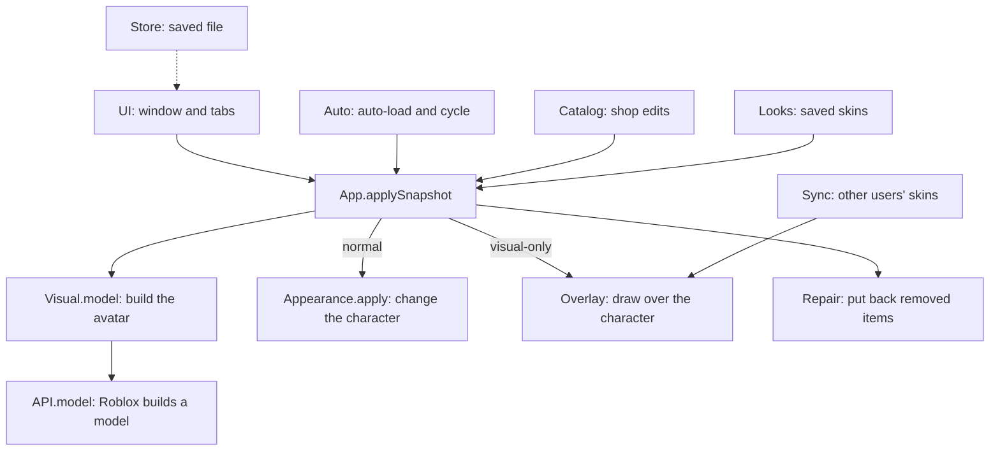

[Docs](../README.md) / Reference / **Architecture**

#  Architecture

Avatar Copier is one Luau file, [`src/avatar-copier.lua`](../../src/avatar-copier.lua). It has no build step and loads no code at run time; even the icon sheet and the logo are embedded as base64. Each area of the script is a local table of functions, defined in this order:

| Table | Role |
| --- | --- |
| [`Config`](../../src/avatar-copier.lua#L8-L26) | Startup options and hotkeys ([Configuration](configuration.md)) |
| [`Rig`](../../src/avatar-copier.lua#L43) | The joint graph of a model: which parts are connected to `HumanoidRootPart`, posing a model from its joints, adding missing joints from rig attachments |
| [`API`](../../src/avatar-copier.lua#L118) | Roblox avatar calls with a fallback from the `Async` names to the older ones |
| [`S`](../../src/avatar-copier.lua#L150), [`F`](../../src/avatar-copier.lua#L151) | Shared state and helpers: animation reloading, the free camera, tag visibility, the hotkey handler and a few older pieces that live code still reaches (see [Legacy code](development.md#legacy-code)) |
| [`Appearance`](../../src/avatar-copier.lua#L274) | Changes a live character to look like a built avatar model |
| [`Codec`](../../src/avatar-copier.lua#L690) | `HumanoidDescription` to plain table and back |
| [`Visual`](../../src/avatar-copier.lua#L802) | Visual snapshots: the exact parts, meshes, attachments and effects of a character, validated and rebuilt |
| [`Store`](../../src/avatar-copier.lua#L1243) | The saved file: favorites, recent, skins, settings, auto and cycle options |
| [`App`](../../src/avatar-copier.lua#L1429) | Session state, profile lookup, and `App.applySnapshot`, the one function that changes your character |
| [`Repair`](../../src/avatar-copier.lua#L1556) | Puts back avatar items the game removes |
| [`F.Swap`](../../src/avatar-copier.lua#L1607) | The glow and sparkle shown when the avatar changes |
| [`Auto`](../../src/avatar-copier.lua#L1650-L1651) | Auto-load on start and the avatar cycle ([Auto & Cycle](../tabs/auto-cycle.md)) |
| [`Catalog`](../../src/avatar-copier.lua#L1830) | Catalog search, bundles and editing the worn avatar ([Roblox Shop](../tabs/roblox-shop.md)) |
| [`Looks`](../../src/avatar-copier.lua#L2283) | Saved skins: capture, import and share codes ([Saved Skins](../tabs/saved-skins.md)) |
| [`Toast`](../../src/avatar-copier.lua#L2638) | A self-contained notification component |
| [`UI`](../../src/avatar-copier.lua#L2826-L2827) | The window, its pages and every input that reaches them |
| [`Overlay`](../../src/avatar-copier.lua#L804) | Local models drawn over a character ([Visual-only mode](../features/visual-only.md) and [Skin sync](../features/skin-sync.md)) |
| [`Sync`](../../src/avatar-copier.lua#L804) | The skin sync client |

`Overlay`, `Sync` and `Auto` are declared before `App.applySnapshot` and filled in later, because the apply path needs to reach them before their functions are defined.



## Starting up

1. If a previous run left `_G.Copier_Cleanup`, it [runs first](../../src/avatar-copier.lua#L28 "pcall(_G.Copier_Cleanup)"), and `_G.Copier_ExecutionID` is incremented. Loops and delayed tasks check [`IsAlive`](../../src/avatar-copier.lua#L30) (their execution id is still the current one) or [`App.alive`](../../src/avatar-copier.lua#L1433) before doing anything, so a closed run stops on its own.
2. Connections left in `_G.Copier_Connections` are disconnected and a new list starts. Every long-lived connection goes through [`RegisterConnection`](../../src/avatar-copier.lua#L41) so cleanup can find it.
3. If `Config.TargetUsername` is `"restore"`, `"stop"` or your own name, [restore mode](../../src/avatar-copier.lua#L139-L147 "targetLower == lp.Name:lower()") runs and the script returns.
4. The hotkey handler, the camera lock and the character listeners are connected.
5. [`Store.load`](../../src/avatar-copier.lua#L1350-L1410) reads the saved file, then the one-time interface size migration runs and [`Store.sync`](../../src/avatar-copier.lua#L1411-L1415) copies the settings into `Config`.
6. The `CharacterAdded` handler (reapply or cycle) and the stand-in watcher on `workspace.DescendantAdded` are connected.
7. Inside an `xpcall`, [the window is built](../../src/avatar-copier.lua#L6089-L6124 "local built,buildError=xpcall(function()"): chat availability is asked first, then every page, the modal and the inputs. The status line and toasts are wired, the initial appearance is captured if a character exists, the window is laid out, and a load problem with the saved file is reported.
8. The `TargetUsername` preview runs if set, the cycle timer starts, the Start hidden hint shows, auto-load runs, the Discord invite is scheduled and skin sync starts.

If building the window fails, `cleanup()` runs and a Roblox notification says so.

## Snapshots

Everything that can be worn is a **snapshot**: a table with `Data` (an encoded description, see [Data formats](data-formats.md#description-codec)) and optional fields such as `Id` and `Name` (a profile), `LookKey` (a saved skin), `Original` (your initial appearance), `Animations` (exact `Animate` ids), `Catalog` and `Change` (a shop edit) and `ForceAnims`. When `Data.Visual` is present the snapshot also carries a visual snapshot of the real parts.

`App.Initial` is your appearance when the script started ([`App.captureInitial`](../../src/avatar-copier.lua#L1500-L1523)), `App.Current` is what you wear, and `App.History` holds the earlier snapshots of the session for Undo and the timeline.

## Applying a snapshot

[`App.applySnapshot`](../../src/avatar-copier.lua#L1654-L1801)`(snapshot, mode, readyChar)` is the only path that changes your character. `mode` is `apply`, `undo`, `restore`, `reapply`, `catalog`, `cycle` or `history`. Previews never use it.

1. It refuses to run while another apply is busy, and captures the initial appearance the first time.
2. It builds the avatar model: [`Codec.decode`](../../src/avatar-copier.lua#L729-L799), then [`Visual.model`](../../src/avatar-copier.lua#L1228-L1241), which asks Roblox for a model with the character's rig type and, when the snapshot has a visual snapshot for that rig, reshapes the model to match it. The last built model is cached per snapshot and rig, so a reapply after a respawn skips the rebuild.
3. With **Reset character first**, it kills the character and waits up to 12 s for the new one. If the game doesn't respawn you, it carries on with the current character when it is still alive.
4. It checks the character is still yours and alive, turns the free camera off and starts the swap glow (not on a reapply).
5. In visual-only mode, [`Overlay.showLocal`](../../src/avatar-copier.lua#L5668-L5672) draws the model over the character. Otherwise [`Appearance.apply`](../../src/avatar-copier.lua#L508-L571) changes the character.
6. Outside visual-only mode, it puts the description on the Humanoid (emotes live there), restores exact animation ids when the snapshot has them or copies the description's animations when **Copy animations** is on, and makes the head's name tags visible.
7. It updates the history, `App.Current` and the Repair watch, and gives automatic scaling back when restoring.
8. Finally it restores anchoring and `RequiresNeck`, ends the glow, frees the temporary instances and reports the result.

The checks in step 4 repeat after every wait, because you can die or respawn at any moment:

```lua excerpt
        assert(char == lp.Character and char.Parent and App.alive(), "Your character changed during the operation. Try again.")
        local hum = char:FindFirstChildOfClass("Humanoid")
        assert(hum and hum.Health > 0, "Wait for your character to respawn.")
```

### `Appearance.apply`

The live character is changed in place: its body parts, joints and Humanoid stay, and only meshes, sizes, joint offsets and avatar items change. That is why the game's tools, welds, tags and attachments survive.

1. [`Appearance.checkLiveRig`](../../src/avatar-copier.lua#L400-L407) stops when a body part is no longer jointed to the root.
2. Only body parts the character really has are changed; it fails only when none match.
3. Automatic scaling is paused (the original value is kept in the `Lyra_OriginalAutomaticScaling` attribute) because the source model is already scaled.
4. Clothing, body colours and the avatar's own accessories are removed. An accessory counts as the avatar's when it was added by the script (`Copier_CopiedItem`), or when it holds no script and matches one of your own avatar's accessories by name ([`Appearance.isAvatarAccessory`](../../src/avatar-copier.lua#L278-L284)). When the source is a visual snapshot, every accessory without a script is removed as well.
5. [`Appearance.copySurface`](../../src/avatar-copier.lua#L343-L368) copies each body part's mesh with `MeshPart:ApplyMesh`, its cosmetic children, colour, transparency and material, and then puts back the physical properties `ApplyMesh` may change. When a game's part rejects `ApplyMesh`, a non-colliding copy of the source part is welded on top and the real part is hidden ([`Appearance.visualFallback`](../../src/avatar-copier.lua#L384-L399)).
6. [`Appearance.fitGeometry`](../../src/avatar-copier.lua#L420-L504) copies sizes, attachment positions (updating attachments in place), joint offsets between changed parts and the scale values. The hip height follows only when every leg part took the new size.
7. Accessories, clothing and body colours are added ([`Appearance.item`](../../src/avatar-copier.lua#L337-L342)). Each added item is tagged `Copier_CopiedItem` and `Lyra_ItemKey`; accessories are attached with `Humanoid:AddAccessory` and, when that doesn't connect them, welded by hand ([`Appearance.attach`](../../src/avatar-copier.lua#L286-L335)).

The returned report lists the added items (for Repair), what was skipped and the body parts that were missing.

```lua excerpt
    -- Custom characters often miss parts. Apply what matches and only fail when nothing does.
    local expected, missing = {}, {}
    for _,source in ipairs(sourceModel:GetChildren()) do
        if Appearance.isBody(source,sourceModel) and source.Name~="HumanoidRootPart" then
            if Appearance.isBody(character:FindFirstChild(source.Name),character) then expected[source.Name]=true
            else table.insert(missing,source.Name) end
        end
    end
    assert(next(expected),"This game's character has none of the expected body parts ("..table.concat(missing,", ")..").")
```

## Visual snapshots

[`Visual.capture`](../../src/avatar-copier.lua#L1013-L1052) walks your character and records each body part (class, size, colour, transparency, material, mesh and texture ids) with its children from an allowlist of classes ([`Visual.schemas`](../../src/avatar-copier.lua#L821-L831)), the accessories, clothing, colours, scale values, every body joint offset, the hip height and the animation ids. [`Visual.validate`](../../src/avatar-copier.lua#L977-L1012) checks every value against fixed ranges before anything is built from it, whether it comes from your own file, a share code or another player.

[`Visual.overlay`](../../src/avatar-copier.lua#L1143-L1227) rebuilds a snapshot on a model from `API.model`: it replaces meshes (loaded with `AssetService:CreateMeshPartAsync` and cached, up to 64), restores the children, sets joint offsets, recreates accessories and clothing and sets the scale values and hip height. Old JSON backups have no joints, so their offsets are estimated from the size change.

## Overlays

`Overlay` draws a separate local model over a character and hides the real body on your screen. It is used for your own character in visual-only mode and for other players in skin sync. The overlay folder lives in the camera, which is local and out of reach of game scripts that scan the workspace.

Each overlay follows its character in one of two ways, chosen per character:

- **joints**, for standard rigs: the overlay root follows the real root, lifted by the difference in standing height, and each overlay joint takes the rotation of the matching real limb.
- **parts**, for everything else: each overlay part is placed on the visible part with the same name.

Every frame, the parts that move are placed with one `workspace:BulkMoveTo` call ([`Overlay.start`](../../src/avatar-copier.lua#L5868-L5930)).

Some games draw the visible body as a separate model named after the player (Evade keeps it in `workspace.Rigs`); the overlay follows and hides that model instead. About twice a second each overlay relinks rebuilt parts, hides what loaded late and keeps itself out of physics. If the game removes an overlay, it is rebuilt from a spare copy, up to 20 times. More in [Visual-only mode](../features/visual-only.md).

## Interface

The UI is built from plain Roblox instances in one `ScreenGui` named `CopierHubGUI`, plus a `BlurEffect` in Lighting. [`UI.buildShell`](../../src/avatar-copier.lua#L3476-L3544) makes the window, the side rail and the floating button; one `UI.build*` function per tab makes each page (the [tab pages](../README.md#the-tabs) link each one). [`UI.layout`](../../src/avatar-copier.lua#L3582-L3687) sizes everything from the screen size, the interface scale and the saved window size, and switches between the wide rail, the icon rail and the phone drawer. More in [The window](../features/window.md).

Lists that are rebuilt often (players, favorites, skins, shop cards, cycle rows, the timeline) keep their connections in `UI.Rows[key]`, so a rebuild disconnects the old rows first ([`UI.clearRows`](../../src/avatar-copier.lua#L4083-L4087), [`UI.rowConnect`](../../src/avatar-copier.lua#L4088-L4090)).

## Globals and names

The script keeps these keys in `_G`: `Copier_Cleanup`, `Copier_ExecutionID`, `Copier_Connections`, `Copier_UIHidden`, `Copier_LeftToolClone`, `Copier_ToolsGiverToggle`, `ToolsGiverActive`, `Copier_TargetID`, `Copier_FCControls` and `Copier_UIAnnihilator` (the last three are leftovers that are only read or cleared).

Instances it creates are named `CopierHubGUI`, `CopierLiquidBlur`, `LyraCopierCommand` (a `TextChatCommand`), `LyraSkinOverlays`, `LyraSkinOverlay`, `LyraSwapGlow`, `LyraSwapBurst`, `LyraVisual_<part>`, `LyraMenuAvatar` and `LyraToasts`. Attributes start with `Copier_` or `Lyra_`. The free camera binds the render step `CopierFreeCam`.

## Cleanup

[`cleanup`](../../src/avatar-copier.lua#L6063-L6086) (also `_G.Copier_Cleanup`) stops Repair and the animation reloads, closes the app so every loop exits, turns off the free camera and the hidden interface, disconnects every registered connection and row connection, cancels tweens, removes the toasts, the menu avatar, the skin sync (telling the server you left), every overlay, the window, the blur and the chat command, and destroys the cached models and descriptions. Avatar items already on your character stay; Restore is the way to remove them.

---

| ← Previous | Up | Next → |
| :--- | :---: | ---: |
| [Visual-only mode](../features/visual-only.md) | [All docs](../README.md) | [Lifecycle](lifecycle.md) |
