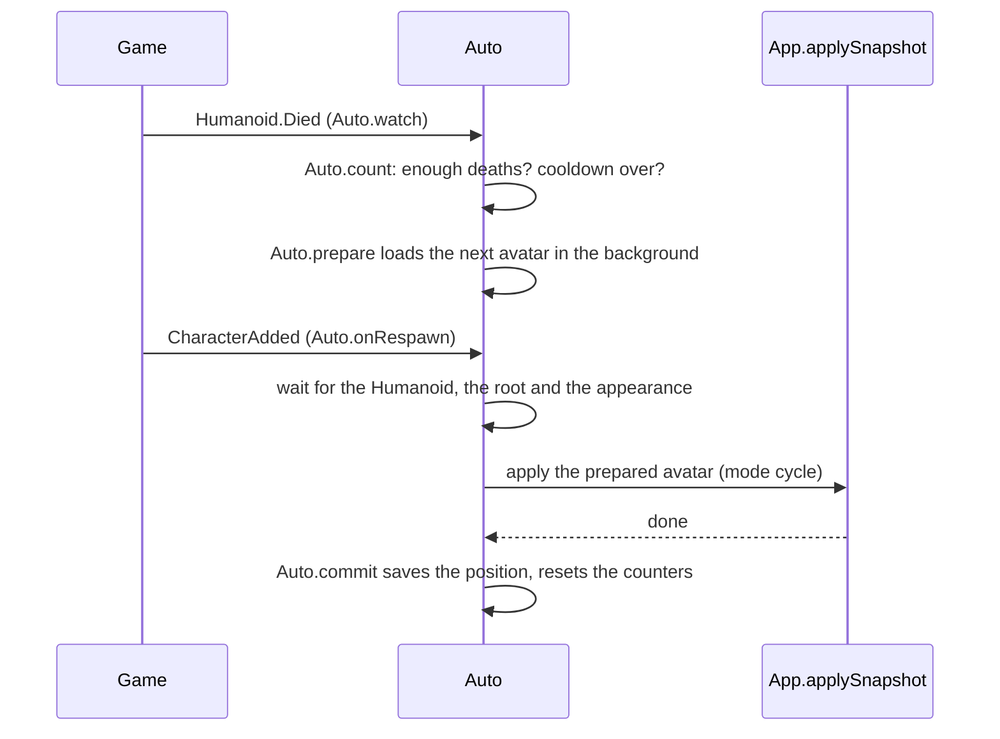

[Docs](../README.md) / Tabs / **Auto & Cycle**

#  Auto & Cycle

Two automatic helpers:

- **Auto-load on execute** puts an avatar on as soon as you run the script, so you don't have to search for it every time.
- **Avatar cycle** switches through a list of avatars while you play: every death, every respawn, or on a timer.

## Try it: wear the same avatar every time

1. Preview someone in [Copy Avatar](copy-avatar.md) (or a skin in [Saved Skins](saved-skins.md)).
2. Open **Auto & Cycle** and, on the **Chosen avatar** card, tap **Preview**.
3. Turn on **Apply an avatar on start**.

Next time you run the script, that avatar goes on by itself.

## Try it: a new avatar every death

1. Add a few avatars to the **Cycle list** (**Add preview**, **Add current** or **Add favorites**).
2. Turn on **Cycle avatars**.
3. Play. After each death, the next avatar is ready when you respawn.

## Auto-load on execute

| Control | Default | What it does |
| --- | --- | --- |
| **Apply an avatar on start** | Off | Applies an avatar when the script starts and your character is ready. |
| **Which avatar to apply** | Chosen avatar | **Chosen avatar**, **Last applied**, **Random favorite** or **Cycle position** (the cycle's current avatar). |
| **Chosen avatar** card | None | **Preview** uses what is in the 3D preview, **Current** what you wear, **Clear** removes it. |
| **This game only** card | None | Same buttons. Set here, it always wins for this place, whatever the source above says. |
| **Delay before loading** | 2 s | Waits 0 to 30 s after you spawn, for games that change your look on spawn. |
| "Last applied: …" | | The avatar the **Last applied** source would use. |

> [!NOTE]
> Auto-load is skipped when `Config.TargetUsername` is set at the top of the script (see [Configuration](../reference/configuration.md)).

## Avatar cycle

**Cycle avatars** turns the cycle on. **Show advanced options** opens the rest:

| Option | Default | Choices |
| --- | --- | --- |
| **Switch when** | On death | **On death** (the game's death event), **On respawn** (every new character, for games that reset you without killing you), **On a timer**, **Death or timer** |
| **Deaths per switch** | 1 | 1 to 50 deaths (or respawns) |
| **Timer interval** | 2 min | 10 s to 60 min |
| **Order** | In order | **In order**; **Shuffle** (everyone once per round, never starting a round with the avatar you wear); **Random** (never the one you wear); **Ping-pong** (to the end and back) |
| **At the end of the list** | Start over | **Start over**, **Stay on last**, **Restore mine** (your own avatar). For In order only. |
| **Cooldown** | 3 s | 0 s to 5 min between two switches, so quick deaths don't skip avatars |
| **Remember position** | On | Continue from the same avatar next time you run the script |
| **Notify on switch** | On | A small notification with the new avatar's name (needs **Show notifications** in [Settings](settings.md)) |

### The status card

Shows what you wear ("Wearing 2/5 · @name"), then how many deaths are left before the next switch, the timer, the cooldown and the deaths this session.

| Button | What it does |
| --- | --- |
| **Previous** / **Next** | Switch now. |
| **Reset** | Sets the counters to zero; the next switch starts at the top of the list. |

### The cycle list

Up to 50 Roblox profiles or saved skins.

| Control | What it does |
| --- | --- |
| **Add preview** / **Add current** | Adds what is in the preview, or what you wear. |
| **Add favorites** | Adds every favorite that isn't in the list yet. |
| **Clear list** | Empties the list after you confirm. |
| Number or picture | **Drag** it up or down to reorder. |
| **Wear** | Jumps to that avatar now. |
| **X** | Removes it from the list. |

> [!TIP]
> In chat: `/e next`, `/e prev`, and `/e cycle` to turn the cycle on or off. The `/e` versions don't show up in the chat window.

## How a death becomes the next avatar



Because the next avatar loads **during** the respawn timer, it is ready when the new character appears. Deaths caused by **Reset character first** (in [Settings](settings.md)) don't count.

## Under the hood

| Part | Code | What it does |
| --- | --- | --- |
| The page | [`UI.buildAuto`](../../src/avatar-copier.lua#L5228-L5302) | Every card, toggle, dropdown and button on this tab. |
| Redrawing | [`UI.renderAuto`](../../src/avatar-copier.lua#L5481-L5495), [`UI.autoStatus`](../../src/avatar-copier.lua#L5454-L5480) | The list, the labels and the live status (updated every second). |
| Auto-load | [`Auto.boot`](../../src/avatar-copier.lua#L2899-L2927) | Waits for your character, its appearance and the delay, then applies. |
| Which avatar | [`Auto.startEntry`](../../src/avatar-copier.lua#L2880-L2898) | This game's avatar first, then the chosen source. |
| Next in the list | [`Auto.pick`](../../src/avatar-copier.lua#L2723-L2753) | In order, shuffle, random, ping-pong and the end-of-list action. |
| Loading it | [`Auto.prepare`](../../src/avatar-copier.lua#L2755-L2772), [`Auto.resolve`](../../src/avatar-copier.lua#L2711-L2721) | Tries up to 5 entries, skipping ones that can't load. |
| Deaths | [`Auto.watch`](../../src/avatar-copier.lua#L2853-L2862), [`Auto.count`](../../src/avatar-copier.lua#L2813-L2828) | Counts deaths and starts loading the next avatar. |
| Respawn | [`Auto.onRespawn`](../../src/avatar-copier.lua#L2830-L2852) | Applies the prepared avatar to the new character. |
| Timer | [`Auto.startTimer`](../../src/avatar-copier.lua#L2863-L2878) | Checks once per second. |
| Switch now | [`Auto.switchNow`](../../src/avatar-copier.lua#L2781-L2795) | Previous, Next, Wear and the chat commands. |
| Reordering | [`UI.startCycleDrag`](../../src/avatar-copier.lua#L5384-L5430), [`Auto.move`](../../src/avatar-copier.lua#L2796-L2806) | The drag line and moving the entry (the current position follows). |
| List entries | [`Auto.entryFrom`](../../src/avatar-copier.lua#L2686-L2693), [`Store.entry`](../../src/avatar-copier.lua#L1598-L1610) | A profile is stored as id and names, a skin as its key. Never the avatar itself. |

### Shuffle: everyone once, then a new round

```lua excerpt
    elseif auto.Order == "Shuffle" then
        for i = #Auto.Bag, 1, -1 do if Auto.Bag[i] > count then table.remove(Auto.Bag, i) end end
        if #Auto.Bag == 0 then
            -- Every avatar once per round; a new round never starts with the avatar being worn.
            for i = 1, count do table.insert(Auto.Bag, i) end
            for i = #Auto.Bag, 2, -1 do local j = Auto.Rng:NextInteger(1, i); Auto.Bag[i], Auto.Bag[j] = Auto.Bag[j], Auto.Bag[i] end
            if Auto.Bag[count] == current then Auto.Bag[count], Auto.Bag[1] = Auto.Bag[1], Auto.Bag[count] end
        end
```

### A death only switches after the threshold and the cooldown

```lua excerpt
    Auto.DeathsSince = Auto.DeathsSince + 1
    -- During the cooldown the counter is kept, so the next death after it switches.
    if Auto.DeathsSince < auto.EveryDeaths or os.clock() - Auto.LastSwitch < auto.Cooldown then Auto.OnChange(); return end
    local pending = {Done = false}
    Auto.Pending = pending
```

### A game-specific avatar always wins

```lua excerpt
function Auto.startEntry()
    local auto = Store.Auto
    local perGame = auto.Games[tostring(game.PlaceId)]
    if perGame then return perGame, nil, "this game's avatar" end
    if auto.LoadSource == "Last" then return auto.Last, nil, "last applied avatar" end
```

### Roblox APIs used

| API | Used for |
| --- | --- |
| `Humanoid.Died`, `Player.CharacterAdded` | Counting deaths and respawns |
| `Player:HasAppearanceLoaded` | Waiting until the game finished dressing you |
| `game.PlaceId` | The "This game only" avatar |
| `Random.new()` | Shuffle and random order |

## Messages you may see

| Message | Meaning |
| --- | --- |
| "Auto-load is on, but no chosen avatar is set. Choose one in Auto & Cycle." | Pick an avatar for the selected source, or turn auto-load off. |
| "Add avatars to the cycle list first." | The list is empty. |
| "The avatar cycle reached the end of the list." | In order + Stay on last. |
| "Avatar cycle: now wearing …" | A switch worked. |

---

| ← Previous | Up | Next → |
| :--- | :---: | ---: |
| [Roblox Shop](roblox-shop.md) | [All docs](../README.md) | [Settings](settings.md) |
