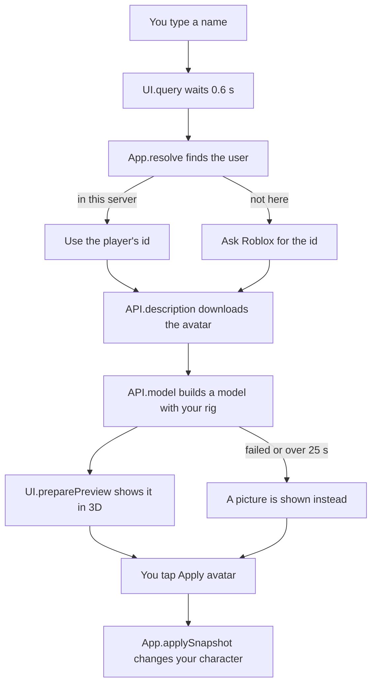

[Docs](../README.md) / Tabs / **Copy Avatar**

#  Copy Avatar

The first tab. You type someone's Roblox name, look at their avatar in 3D, and put it on your character with one tap. Below the preview, the **timeline** keeps every look you wore this session, so you can always go back.

> [!NOTE]
> Only you see the new avatar. Other players keep seeing your normal one (animations are the exception, see [What other players see](../reference/compatibility.md#what-other-players-see)).

## Try it

1. Type a username, `@username` or a user ID in the search box.
2. Wait a moment, or press <kbd>Enter</kbd>. The avatar appears in the **3D preview**.
3. Drag the preview to turn it around. When you like it, tap **Apply avatar**.
4. Changed your mind? Tap **Undo**, a picture in the timeline, or **Restore** to get your own look back.

> [!TIP]
> A user ID always works, even when a name doesn't. You can find it in the profile link: `roblox.com/users/`**`156`**`/profile`.

## What every control does

| Control | What it does |
| --- | --- |
| **Search box** | Takes a username (3 to 20 letters, digits or `_`, with or without `@`) or a numeric user ID. It searches 0.6 s after you stop typing. |
| **Arrow button** / <kbd>Enter</kbd> | Searches right away. Also retries after a timeout. |
| **3D preview** | Drag to rotate. Mouse wheel or **−** / **+** to zoom. The circular arrow resets the view. |
| **Apply avatar** | Puts the previewed avatar on your character. Shows "Applying…" while it works. |
| **Add favorite** | Stars the profile so it shows up in [Favorites & Recent](favorites-recent.md). Tap again to remove it (it asks first). |
| **Timeline** pictures | Every look of this session, oldest on the left. "Now" is what you wear, "Original" is your own avatar. Tap one to go back to it. |
| **Undo** | Goes back one step. |
| **Customize** | Opens the [Roblox Shop](roblox-shop.md) on the list of items you are wearing, so you can remove or add items. |
| **Restore** | Puts back the avatar your character had when the script started. |

## Good to know

- **Players in your server are found first.** Typing the exact name of someone in the server skips the online lookup.
- **Profiles are kept for two minutes** (up to 20), so searching the same person again is instant.
- **The preview uses your character's rig.** On an R6 game you see the R6 version, which is what will be applied.
- **The preview never touches your character.** It is a separate model inside the window.
- **Every profile you preview goes into Recent.**
- **The timeline holds 12 earlier looks** plus the current one, and starts empty every time you run the script.

> [!WARNING]
> If you ran the script while already wearing a copied avatar, that avatar becomes the "Original" that **Restore** goes back to. Respawn first to start from your real avatar. See [Restore left items on my character](../troubleshooting.md#restore-left-items-on-my-character).

## What happens when you search and apply



## Under the hood

### Where to look in the script

| Part | Code | What it does |
| --- | --- | --- |
| The page | [`UI.buildAvatar`](../../src/avatar-copier.lua#L4254-L4312) | Creates the search box, the preview card, the profile card and the timeline, and connects dragging and zooming. |
| Searching | [`UI.query`](../../src/avatar-copier.lua#L4378-L4422) | Waits 0.6 s, cancels older searches with a token, gives up after 25 s, then builds the preview. |
| Finding the user | [`App.resolve`](../../src/avatar-copier.lua#L1801-L1839) | Checks the text, looks in the server, asks Roblox for the id, name, display name and avatar, and caches the result. |
| Preparing the 3D model | [`UI.preparePreview`](../../src/avatar-copier.lua#L4336-L4361) | Removes scripts, anchors the root, turns off collisions and reconnects loose parts. |
| The camera | [`UI.camera`](../../src/avatar-copier.lua#L4314-L4322) | Frames the model from its size, the rotation, the tilt and the zoom. |
| Image fallback | [`UI.previewFallback`](../../src/avatar-copier.lua#L4368-L4376) | Shows the Roblox avatar picture when the 3D model can't be built. |
| Apply | [`App.applyPreview`](../../src/avatar-copier.lua#L2142-L2147) | Turns the previewed profile into a snapshot and hands it to `App.applySnapshot`. |
| The one apply path | [`App.applySnapshot`](../../src/avatar-copier.lua#L1994-L2141) | Builds the avatar, checks your character after every wait and changes it. Explained in [Architecture](../reference/architecture.md#applying-a-snapshot). |
| Undo, timeline, Restore | [`App.undo`](../../src/avatar-copier.lua#L2148-L2150), [`App.jump`](../../src/avatar-copier.lua#L2151-L2154), [`App.restore`](../../src/avatar-copier.lua#L2165-L2167) | Apply an earlier snapshot with the mode `undo`, `history` or `restore`. |
| Drawing the timeline | [`UI.renderTimeline`](../../src/avatar-copier.lua#L5620-L5655) | One picture per snapshot; skipped when nothing changed. |
| Buttons on and off | [`UI.refresh`](../../src/avatar-copier.lua#L5656-L5670) | Enables Apply, Undo, Restore and Customize only when they can do something. |

### The search waits for you to stop typing

Each keystroke raises `App.QueryToken`. A search only continues while its own token is still the newest, so typing fast never starts ten lookups.

```lua excerpt
function UI.query(raw,immediate)
    App.QueryToken=App.QueryToken+1; local token=App.QueryToken
…
    task.delay(immediate and 0 or 0.6,function()
        local function valid() return App.alive() and token==App.QueryToken end
        if not valid() then return end
```

### What counts as a valid name

Spaces and a leading `@` are removed. A number is read as a user ID. Anything else must look like a Roblox username.

```lua excerpt
function App.resolve(raw, valid)
    local text = tostring(raw):match("^%s*(.-)%s*$"):gsub("^@", "")
    local id = Codec.id(text)
    if not id and (not text:match("^[%w_]+$") or #text < 3 or #text > 20 or text:match("^%d+$")) then
        return nil, "Enter a valid username or numeric user ID."
    end
```

### Apply hands a snapshot to the apply path

A **snapshot** is a plain table describing a look. `Data` is the avatar description turned into a table by `Codec.encode` (see [Data formats](../reference/data-formats.md#description-codec)).

```lua excerpt
function App.applyPreview()
    if not App.Preview or App.Busy then return end
    local profile = App.Preview
    local snapshot = {Data = profile.SnapshotData or Codec.encode(profile.Description), Id = profile.Id, Name = profile.Name, LookKey = profile.LookKey}
    task.spawn(App.applySnapshot, snapshot, "apply")
end
```

### How the timeline is kept

After a successful change, the look you had before goes into `App.History`. Undo removes the last entry; a jump moves the chosen entry instead of copying it. Only the newest 12 are kept.

```lua excerpt
        if mode == "undo" then table.remove(App.History)
        elseif mode ~= "reapply" and previous then
…
            table.insert(App.History, previous); while #App.History > 12 do table.remove(App.History, 1) end
        end
        App.Current = snapshot
```

### Roblox APIs used

| API | Used for |
| --- | --- |
| `Players:GetUserIdFromNameAsync`, `Players:GetNameFromUserIdAsync` | Turning a name into an id and back |
| `UserService:GetUserInfosByUserIdsAsync` | The display name |
| `Players:GetHumanoidDescriptionFromUserIdAsync` | The avatar ([`API.description`](../../src/avatar-copier.lua#L122-L127)) |
| `Players:CreateHumanoidModelFromDescriptionAsync` | The 3D model ([`API.model`](../../src/avatar-copier.lua#L128-L133)) |
| `ViewportFrame`, `WorldModel`, `Camera` | Showing the model inside the window |
| `rbxthumb://type=AvatarHeadShot` and `type=Avatar` | The small picture and the image fallback |

The older names without `Async` are tried when the new ones fail, so the script also works on executors that only expose those.

## Messages you may see

| Message | Meaning |
| --- | --- |
| "Enter a valid username or numeric user ID." | The text can't be a Roblox name. |
| "User not found or the service is unavailable. Check the username." | The name doesn't exist, or Roblox didn't answer. Try the user ID. |
| "Preview ready. Tap Apply avatar when you are ready." | Everything worked. |
| "3D preview unavailable. You can still apply the avatar." | The picture is shown instead of the 3D model. Applying still works. |
| "Wait for your character to load." | You have no character yet. |

More in [Troubleshooting](../troubleshooting.md#applying-an-avatar).

---

| ← Previous | Up | Next → |
| :--- | :---: | ---: |
| [Getting started](../getting-started.md) | [All docs](../README.md) | [Server](server.md) |
