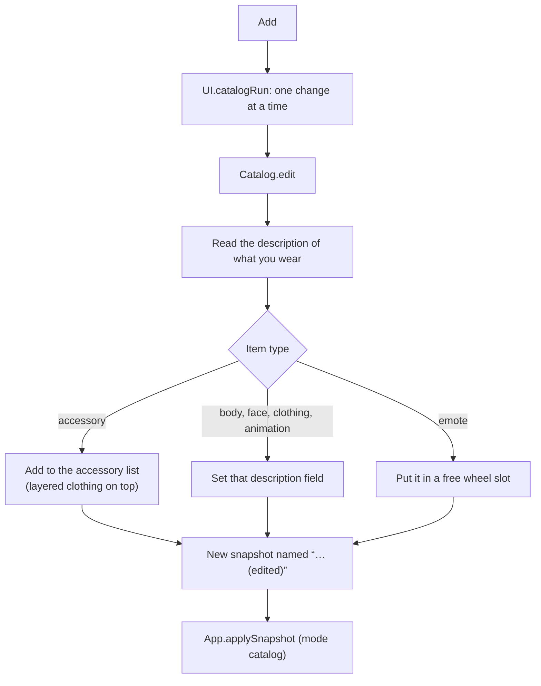

[Docs](../README.md) / Tabs / **Roblox Shop**

#  Roblox Shop

Try anything from the Roblox catalog on the avatar you are wearing: hats, hair, faces, clothes, whole bodies, animations and emotes. **Add** puts an item on, **Remove** takes it off. Nothing is bought, and only you see the change.

> [!NOTE]
> Shop changes go through the same path as any other avatar change, so each one appears in the [timeline](copy-avatar.md#what-every-control-does) and **Undo** takes it back.

## Try it

1. Open **Roblox Shop**. The **Search** view opens on the most popular items.
2. Type a name (for example `Korblox`) and press <kbd>Enter</kbd>, or pick a filter such as **Hair**.
3. Tap **Add** on a card. The item appears on your avatar a moment later.
4. Open **Wearing** to see everything you have on and **Remove** what you don't want.

> [!TIP]
> **Customize** in Copy Avatar opens this tab straight on **Wearing**: copy someone's avatar, then swap the parts you don't like.

## Search

| Control | What it does |
| --- | --- |
| Search box | A name, an item ID, a catalog link (`…/catalog/<id>/…`) or a bundle link (`…/bundles/<id>/…`). Up to 50 characters. |
| Filter chips | **All, Limiteds, Bodies, Heads, Hair, Hats, Accessories, Clothing, Faces, Animations, Emotes.** |
| Second row | Shown for **Clothing** (classic shirts, classic pants, classic T-shirts, layered clothing) and **Accessories** (face, neck, shoulder, front, back, waist). |
| Sort | **Most popular** (all time, the default), best selling, best match, newest, price low to high, price high to low. |
| Price | Any price, for sale only, free, up to R$ 100, R$ 100 to 1,000, R$ 1,000 and up. |
| Card | Picture, name and a caption with the type, "Limited", the price, "Free" or "Off sale". A green check means you are wearing it. |
| Card button | **Add**, **Remove** (when worn), **View parts** (bundles) or **Not wearable** (gear and other items that can't go on an avatar). |
| **Load more** | Continues the same search. |

> [!NOTE]
> A bare number is looked up as an **item first** and as a bundle only when no wearable item has that ID, because item IDs and bundle IDs overlap. Use the bundle link to be sure.

Off-sale items are listed unless you pick a price filter: they still load on a local avatar.

## Bundles

Tapping a card marked **BUNDLE** opens its parts, body parts first.

| Control | What it does |
| --- | --- |
| **Back to results** | Returns to the search. |
| **Add all (N)** | Adds every part you aren't wearing yet. Says "All added" when there is nothing left. |
| **Remove all** | Removes every part of the bundle you are wearing. |
| Part rows | **Add** or **Remove** one part. |

A removed body part goes back to the default Roblox shape.

## Wearing

Lists every item on your current appearance, grouped into **Body & face**, **Accessories**, **Clothing**, **Animations** and **Other**, each with **Remove**. The card at the top says whose avatar you are editing.

> [!WARNING]
> Editing a **saved skin** rebuilds it from its catalog items, so details only the saved copy had (custom meshes, effects) are dropped. The Wearing view says so above the list.

## The undo bar

After a change, a bar at the top shows what you did ("Added Korblox Deathspeaker - Right Leg", "Removed 4 parts of …") with its picture and an **Undo** button.

## Emotes

An added emote goes into the first free slot of your emote wheel (slot 8 when all are taken) and plays once so you can see it.

## What happens when you tap Add



## Under the hood

| Part | Code | What it does |
| --- | --- | --- |
| The page | [`UI.buildCatalog`](../../src/avatar-copier.lua#L4646-L4703) | Search / Wearing buttons, undo bar, search box, chips, dropdowns, grid and bundle panel. |
| Running a search | [`UI.catalogSearch`](../../src/avatar-copier.lua#L4475-L4502) | Builds the query from the box and the filters, draws the cards, shows **Load more**. |
| Searching | [`Catalog.search`](../../src/avatar-copier.lua#L2079-L2104) | IDs and links go to `Catalog.byId`; text goes to the in-game catalog, or to the web catalog when that fails. |
| Search parameters | [`Catalog.params`](../../src/avatar-copier.lua#L2005-L2028) | Turns the filter, sort and price into `CatalogSearchParams`. |
| Web fallback | [`Catalog.web`](../../src/avatar-copier.lua#L2030-L2045) | Calls `catalog.roblox.com` with `game:HttpGet`. |
| Reading results | [`Catalog.normalize`](../../src/avatar-copier.lua#L1954-L1979), [`Catalog.read`](../../src/avatar-copier.lua#L1996-L2004) | One shape for both sources; drops what the filters don't allow. |
| Item types | [`Catalog.Types`](../../src/avatar-copier.lua#L1834-L1874) | Asset type id → description field or accessory type, label and sort rank. |
| Filters | [`Catalog.Categories`](../../src/avatar-copier.lua#L1882-L1895), [`Catalog.SubCategories`](../../src/avatar-copier.lua#L1901-L1908) | Which asset or bundle types each chip shows. |
| Sorts and prices | [`Catalog.Sorts`](../../src/avatar-copier.lua#L1914-L1921), [`Catalog.Prices`](../../src/avatar-copier.lua#L1922-L1929) | The dropdown choices. |
| IDs and links | [`Catalog.idFrom`](../../src/avatar-copier.lua#L2047-L2057), [`Catalog.byId`](../../src/avatar-copier.lua#L2059-L2077) | Item first, bundle second. |
| Bundles | [`Catalog.bundle`](../../src/avatar-copier.lua#L2106-L2142), [`UI.openBundle`](../../src/avatar-copier.lua#L4514-L4556) | Loads the parts, finds each part's type, sorts body parts first. |
| What you wear | [`Catalog.worn`](../../src/avatar-copier.lua#L2147-L2177), [`UI.renderWearing`](../../src/avatar-copier.lua#L4572-L4601) | Every asset id in the current snapshot, grouped for the Wearing view. |
| Add / Remove | [`UI.catalogRun`](../../src/avatar-copier.lua#L4417-L4426) → [`Catalog.edit`](../../src/avatar-copier.lua#L2186-L2280) | Edits a copy of the description and applies it. |
| Card buttons | [`UI.catalogAction`](../../src/avatar-copier.lua#L4391-L4416) | Picks Add, Remove, View parts or Not wearable and keeps it up to date. |
| Undo bar | [`UI.catalogUndoBar`](../../src/avatar-copier.lua#L4602-L4615) | Shown while the current look is a shop change. |

### Most popular, of all time, is the default

So a search for "korblox" leads with the original item instead of this week's copies:

```lua excerpt
-- Most popular (all time) is the default so searches like "korblox" lead with the original item.
Catalog.Sorts = {
    {Value = "Popular", Label = "Most popular", Enum = {"MostFavorited"}, Web = 1, AllTime = true},
```

### In-game search first, web catalog second

```lua excerpt
    local ok, pages = pcall(function() return Catalog.AvatarEditor:SearchCatalog(Catalog.params(query)) end)
    if ok and pages then
        query.Pages = pages; query.Finished = pages.IsFinished
        return Catalog.read(pages:GetCurrentPage(), query)
    end
    warn("[Lyra Catalog] In-game search unavailable, using the web catalog: " .. tostring(pages))
    return Catalog.web(query)
```

### Adding an accessory or a body part

Accessories go into the description's accessory list; layered clothing gets the next layer order so it sits on top. Body parts, faces, classic clothing and animations replace a description field:

```lua excerpt
            elseif item.Kind and item.Kind.Accessory then
                local row = {AssetId = item.Id, AccessoryType = Enum.AccessoryType[item.Kind.Accessory], IsLayered = item.Kind.Layered == true}
                if row.IsLayered then top = math.min(1000, top + 1); row.Order = top end
                table.insert(accessories, row); changed = changed + 1
…
            elseif item.Kind and item.Kind.Field then
                desc[item.Kind.Field] = item.Id; changed = changed + 1
```

### The change becomes a new snapshot

```lua excerpt
    local snapshot = {Data = data, Name = name .. " (edited)", Catalog = true, ThumbId = base.Id or base.ThumbId, ForceAnims = animations or nil,
…
    local applied = App.applySnapshot(snapshot, "catalog")
```

`ForceAnims` is set only when the change touched an animation item. Otherwise the shop keeps the animations you are playing.

### Roblox APIs used

| API | Used for |
| --- | --- |
| `AvatarEditorService:SearchCatalog` with `CatalogSearchParams` | Searching inside the game |
| `game:HttpGet("https://catalog.roblox.com/v1/search/items/details?…")` | The web fallback |
| `MarketplaceService:GetProductInfo` | Item type, name and price for IDs and bundle parts (cached) |
| `AssetService:GetBundleDetailsAsync` | Bundle parts |
| `HumanoidDescription:GetAccessories`, `SetAccessories`, `GetEmotes`, `SetEmotes`, `SetEquippedEmotes` | Editing the description |
| `Humanoid:PlayEmote` | Playing a new emote once |

## Messages you may see

| Message | Meaning |
| --- | --- |
| "Nothing found. Try another name, filter or price." | No results with these filters. |
| "No catalog item or bundle was found with the ID …" | Neither an item nor a bundle has that number. |
| "The catalog is unavailable right now. Try again in a moment." | Both the in-game search and the web fallback failed. |
| "This item cannot be worn on an avatar." | Gear and similar items. |
| "Roblox rejected this change: …" | Roblox refused the new item list; the rest is its reason. |
| "Catalog change applied." | Done. |

More in [Troubleshooting](../troubleshooting.md#the-shop).

---

| ← Previous | Up | Next → |
| :--- | :---: | ---: |
| [Saved Skins](saved-skins.md) | [All docs](../README.md) | [Auto & Cycle](auto-cycle.md) |
