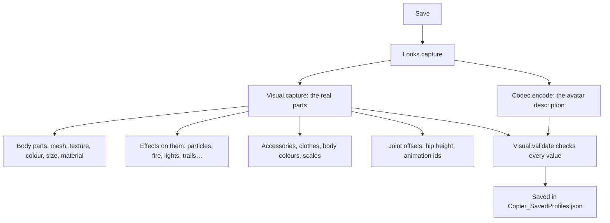

[Docs](../README.md) / Tabs / **Saved Skins**

#  Saved Skins

Your own library of looks. **Save** takes a picture-perfect copy of what your character looks like right now, so you can wear it again later, in any game, or send it to a friend as a code. Inside the window the page is titled **Catalog saves**.

> [!IMPORTANT]
> A saved skin records the **real parts** of your character (meshes, sizes, colours, effects, joints), not just a list of catalog items. That is why a skin built in a "Catalog Creator" game still looks the same in other games.

## Try it

1. Join a Catalog Creator game (or any game) and dress your character the way you want.
2. Open **Saved Skins**, type a name in **Name the skin you're wearing** and tap **Save**.
3. Later, in any game, tap **Wear** on that skin.

The **How it works** link on the page shows the same three steps.

## What every control does

### Saving

| Control | What it does |
| --- | --- |
| **Name the skin you're wearing** | The name of the new skin (up to 48 characters). Empty names become "New skin". |
| **Save** | Captures what your character looks like now and adds it to the top of the library. |

### Your library

| Control | What it does |
| --- | --- |
| **Search your saved skins** | Filters by name or by where the skin came from ("My character · R15", "Shared code"…). |
| Count | "4/100 saved": the library holds up to 100 skins. |
| Picture | A small 3D render of the skin, made one at a time in the background. |
| **Wear** | Puts the skin on your character. |
| Box button | Opens the skin in the [Copy Avatar](copy-avatar.md) 3D preview. **Apply avatar** then wears the saved skin. |
| Pencil | Opens the edit panel below the row (tap again to close it). |

The row says **Wearing now** when that skin is on you.

### The edit panel (pencil)

| Control | What it does |
| --- | --- |
| Name field + **Rename** | Changes the name. |
| **Update** | Captures your current look **over** this skin (same name, new content). |
| **Copy** | Duplicates the skin as "<name> copy". |
| **Share** | Makes a share code, copies it to the clipboard and shows it in **Share & import**. |
| **Cycle** | Adds the skin to the avatar cycle in [Auto & Cycle](auto-cycle.md). |
| **Delete** | Removes it from the library, after you confirm. |

### Share & import

| Control | What it does |
| --- | --- |
| Top box | Shows the last share code (read-only). Select it and copy it when the clipboard doesn't work. |
| Bottom box | Paste a code that starts with `LYRA3:` (or the older `LYRA2:`), or the full text of an old JSON backup. |
| **Import code / JSON** | Checks the code and adds it to the library. An old JSON backup is named after the text in the name field at the top. |

> [!TIP]
> Codes are long. Chat apps and some text boxes cut them, which makes them fail with "Code not recognized." Send them as a file or through a site that keeps the whole text.

> [!WARNING]
> **Save** records every accessory you are wearing, including items the game put on you (a holster, a weapon). Wearing the skin later adds static copies of them. Save where the game hasn't added anything.

## Saved on R15, worn on R6?

Skins are rig specific. When your character uses the other rig, the skin is rebuilt from its avatar description instead, and the status line says:

> This skin was saved on R15 but your character is R6; it was rebuilt from its avatar description, so custom details may differ.

## What Save records



## Under the hood

| Part | Code | What it does |
| --- | --- | --- |
| The page | [`UI.buildLooks`](../../src/avatar-copier.lua#L4667-L4720) | Save, the guide, the search, the list and Share & import. |
| The list | [`UI.renderLooks`](../../src/avatar-copier.lua#L4652-L4666) | Filters `Store.Looks` and draws a row (plus the edit panel for the selected skin). |
| One row | [`UI.lookRow`](../../src/avatar-copier.lua#L4577-L4600) | Picture, name, detail, Wear, preview and pencil. |
| Edit panel | [`UI.lookManage`](../../src/avatar-copier.lua#L4601-L4651) | Rename, Update, Copy, Share, Cycle and Delete. |
| Save / Update | [`UI.captureLook`](../../src/avatar-copier.lua#L4526-L4541) → [`Looks.capture`](../../src/avatar-copier.lua#L2641-L2658) | Refuses while an avatar is being applied, reads the description, captures the parts, saves. |
| Reading the parts | [`Visual.capture`](../../src/avatar-copier.lua#L1353-L1392) | Walks your character and records everything listed above. |
| Checking values | [`Visual.validate`](../../src/avatar-copier.lua#L1317-L1352) | The same limits for your file, share codes and skin sync. See [Limits](../reference/data-formats.md#limits). |
| Share code | [`Looks.share`](../../src/avatar-copier.lua#L2681-L2683) | `LYRA3:` followed by JSON. |
| Import | [`Looks.import`](../../src/avatar-copier.lua#L2659-L2680) | Reads `LYRA3:`, `LYRA2:`, plain JSON and old JSON backups. |
| Old backups | [`Visual.legacy`](../../src/avatar-copier.lua#L1393-L1419) | Converts the old Portuguese-keyed format. |
| Wear | [`UI.wearLook`](../../src/avatar-copier.lua#L4573-L4576) | Applies the skin through `App.applySnapshot`. |
| Preview | [`UI.previewLook`](../../src/avatar-copier.lua#L4542-L4572) | Builds the skin with its own rig in the 3D preview. |
| Building the model | [`Visual.model`](../../src/avatar-copier.lua#L1568-L1581) | Asks Roblox for a model and reshapes it to match the saved parts. |
| Thumbnails | [`UI.lookThumb`](../../src/avatar-copier.lua#L5346-L5374), [`UI.runThumbQueue`](../../src/avatar-copier.lua#L5305-L5345) | Renders skins one at a time and caches them until the skin is updated. |

### A skin can only be saved from your own, settled character

```lua excerpt
function Looks.capture(model, name, existingKey)
    assert(App.alive() and not App.Busy and not App.Dirty, "Wait for the application to finish or restore your character before saving.")
    assert(model == lp.Character, "Capture only accepts your current character.")
    local desc = Looks.description(model)
    local ok, data = pcall(Codec.encode, desc); desc:Destroy()
    assert(ok and data, "Could not save the description.")
    data.Visual = Visual.capture(model, App.captureAnimations(model))
```

### Accessories must be a single part

Each accessory is stored as one handle with its attachment point. One with several parts stops the capture:

```lua excerpt
        elseif part:IsA("Accessory") then
            local handle=part:FindFirstChild("Handle")
            if handle and handle:IsA("BasePart") then
                for _,child in ipairs(part:GetDescendants()) do assert(not child:IsA("BasePart") or child==handle,"Multi-part accessories are not supported: "..part.Name) end
```

### What a share code is

```lua excerpt
function Looks.share(row)
    return "LYRA3:" .. HttpService:JSONEncode({Version = 2, Name = row.Name, Data = row.Data})
end
```

### Imports are checked before anything is built

A code from someone else is outside data. It goes through `Visual.validate` and `Codec.decode`, and is re-encoded, so only known, in-range fields are kept:

```lua excerpt
        assert((packet.Version == 1 or packet.Version == 2) and type(packet.Data) == "table", "Code not recognized.")
        if packet.Data.Visual then Visual.validate(packet.Data.Visual) end
        local valid, desc = pcall(Codec.decode, packet.Data)
        assert(valid and desc, "Incompatible description.")
        data = Codec.encode(desc); desc:Destroy(); data.Visual = packet.Data.Visual
```

The full format is in [Data formats](../reference/data-formats.md#share-codes).

### Roblox APIs used

| API | Used for |
| --- | --- |
| `Humanoid:GetAppliedDescription` | Your description when the Humanoid has none attached |
| `HttpService:JSONEncode`, `JSONDecode`, `GenerateGUID` | Share codes, the saved file and skin ids |
| `AssetService:CreateMeshPartAsync` | Rebuilding saved meshes (cached, up to 64) |
| `setclipboard` / `toclipboard` (executor) | Copying the share code |

## Messages you may see

| Message | Meaning |
| --- | --- |
| "Skin saved using the character's real appearance." | Saved. |
| "Multi-part accessories are not supported: …" | Take that accessory off, or save somewhere it isn't added. |
| "Wait for the application to finish or restore your character before saving." | An avatar is being applied, or the last one failed halfway. |
| "Limit of 100 skins." | Delete some skins first. |
| "Paste a LYRA code or the full contents of the old JSON." / "Code not recognized." | The code is cut short or changed. |
| "Skin kept for this session only; the executor could not save the file." | Your executor can't write files. |

More in [Troubleshooting](../troubleshooting.md#restore-and-saved-skins).

---

| ← Previous | Up | Next → |
| :--- | :---: | ---: |
| [Favorites & Recent](favorites-recent.md) | [All docs](../README.md) | [Roblox Shop](roblox-shop.md) |
