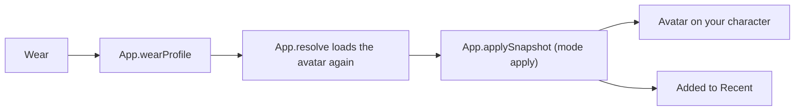

[Docs](../README.md) / Tabs / **Server**

#  Server

Everyone in your Roblox server, in one list. Wear someone's avatar with one tap, look at it first, or star them for later.

## Try it

1. Open **Server** in the side menu.
2. Find the player. Type part of their name, display name or user ID to filter the list.
3. Tap **Wear** to put their avatar on right away, or **Preview** to look at it in 3D first.

## What every control does

| Control | What it does |
| --- | --- |
| **Search players** | Filters by username, display name or user ID. The list updates a moment after you stop typing. |
| Player count | "Showing 3 of 12 players": how many match the filter. |
| **Wear** | Loads the player's avatar and applies it to you. |
| **Preview** | Opens [Copy Avatar](copy-avatar.md) with that player, so you can turn the 3D model around before applying. On narrow windows only the icon is shown. |
| **Star** | Adds the player to [Favorites](favorites-recent.md). If they already are one, it asks before removing them. |

> [!TIP]
> The list is sorted by username and refreshes on its own while the tab is open: players who join appear, players who leave disappear.

## What happens when you tap Wear



**Wear** always fetches the profile again (or takes it from the two-minute cache), so you get the avatar the player has now.

## Under the hood

| Part | Code | What it does |
| --- | --- | --- |
| The page | [`UI.buildPlayers`](../../src/avatar-copier.lua#L4457-L4466) | The search box, the count and the list. Re-renders when someone joins or leaves. |
| Filling the list | [`UI.renderPlayers`](../../src/avatar-copier.lua#L4474-L4485) | Reads `Players:GetPlayers()`, sorts by name and adds a row per match. |
| Filtering | [`UI.matches`](../../src/avatar-copier.lua#L4471-L4473) | Case-insensitive match on name, display name or id. |
| Waiting for typing | [`UI.scheduleList`](../../src/avatar-copier.lua#L4467-L4470) | Re-renders 0.16 s after the last change, so typing doesn't rebuild the list on every key. |
| One row | [`UI.profileRow`](../../src/avatar-copier.lua#L4434-L4450) | The picture, the names and the Wear, Preview and star buttons. Shared with Favorites & Recent. |
| Wear | [`App.wearProfile`](../../src/avatar-copier.lua#L2155-L2164) | Resolves the profile, then applies it. |
| Star | [`UI.toggleFavorite`](../../src/avatar-copier.lua#L5604-L5609), [`App.toggleFavorite`](../../src/avatar-copier.lua#L1786-L1794) | Asks before removing, adds to the top of the list, saves. |

### The list is built from the players in the server

```lua excerpt
function UI.renderPlayers()
    if not UI.PlayerList then return end
    UI.clearRows("players",UI.PlayerList)
    local term=UI.PlayerSearch.Text:lower(); local list=Players:GetPlayers(); local count=0
    table.sort(list,function(a,b) return a.Name:lower()<b.Name:lower() end)
    for _,player in ipairs(list) do
        local profile={Id=player.UserId,Name=player.Name,DisplayName=player.DisplayName}
        if UI.matches(profile,term) then count=count+1; UI.profileRow(UI.PlayerList,profile,count,"players") end
    end
```

`UI.clearRows` disconnects the old rows' buttons before destroying them, so re-rendering never leaves stray connections behind.

### Preview jumps to Copy Avatar

The row's Preview button switches tab, writes the user ID into the search box and searches immediately:

```lua excerpt
    local open=UI.button(row,wide and "Preview" or "",false,function()
        UI.selectTab("Avatar"); UI.SearchBox.Text=tostring(profile.Id or profile.Name); UI.query(UI.SearchBox.Text,true)
    end,"box",key)
```

### Roblox APIs used

| API | Used for |
| --- | --- |
| `Players:GetPlayers()` | The list |
| `Players.PlayerAdded`, `Players.PlayerRemoving` | Keeping the list current |
| `rbxthumb://type=AvatarHeadShot` | The pictures |

---

| ← Previous | Up | Next → |
| :--- | :---: | ---: |
| [Copy Avatar](copy-avatar.md) | [All docs](../README.md) | [Favorites & Recent](favorites-recent.md) |
